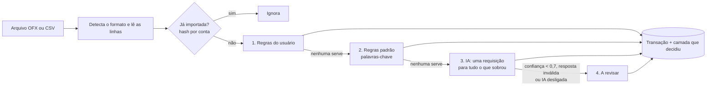

# Finanças com IA

**Importe o extrato do banco e veja cada gasto categorizado: regras resolvem o óbvio, a IA (Claude) entra só no que sobra, e a palavra final é sua.**


<p align="center">
  
</p>

## O problema

Controlar gastos em planilha dá trabalho, e quase todo mundo desiste no segundo mês. A parte chata é classificar cada linha do extrato. Mandar tudo para uma IA resolve, mas é caro, imprevisível e difícil de confiar. Este projeto categoriza em camadas, mostra quem decidiu cada categoria e transforma cada correção do usuário em uma regra para os próximos meses.

## Funcionalidades

- **Login com e-mail e senha** (token Bearer). Cada usuário só vê os próprios dados. A conta demo já vem com 3 meses de transações fictícias.
- **Importação de OFX e CSV**, com detecção automática do formato: CSV do Nubank (cartão e conta), CSV genérico `data;descrição;valor` (valores como `1.234,56`, datas `dd/mm/aaaa`, UTF-8 ou Latin-1) e OFX (inclusive o SGML com tags abertas que muitos bancos exportam).
- **Reimportar não duplica.** Cada linha vira um hash de data + valor + descrição normalizada, por conta. Duas compras iguais no mesmo dia continuam sendo duas.
- **Categorização em 4 camadas**, nesta ordem: (1) regras do usuário, (2) regras padrão com termos e lojas brasileiras (iFood, Uber, 99, Pix, supermercado, farmácia, Netflix, conta de luz…), (3) IA para o que sobrou, numa única requisição com saída estruturada, (4) "A revisar". A camada que decidiu fica salva e aparece na tela como um carimbo.
- **Revisão** com filtros por mês, categoria e "só a revisar". Ao corrigir uma categoria, o app sugere "aplicar a transações parecidas" e cria uma regra (o padrão é editável).
- **Painel** com gastos por categoria no mês e totais de gastos e entradas dos últimos 6 meses. Pagamento de fatura e investimentos não contam como gasto.
- **Avaliação**: um conjunto rotulado com 102 transações fictícias e um script que mede cobertura e acerto (veja os números abaixo).
- **Custo por extrato**: cada importação guarda os tokens usados e o custo estimado da IA.
- **Documentação OpenAPI** em `/docs` (o botão *Authorize* aceita o login da conta demo).
- **Docker Compose** com API, Postgres e front-end.

## Stack

| Camada | Tecnologias |
| --- | --- |
| API | Python 3.14, FastAPI, SQLAlchemy 2 (ORM tipado), Alembic, Pydantic v2, pwdlib (Argon2) |
| IA | SDK oficial da Anthropic, modelo configurável (padrão `claude-haiku-5-5`) |
| Banco | SQLite em desenvolvimento e testes, PostgreSQL em produção (psycopg 3) |
| Qualidade | pytest + cobertura, ruff (lint e formatação), mypy `--strict`, GitHub Actions |
| Web | React 19, TypeScript, Vite, TanStack Query, React Router, CSS puro, Vitest, oxlint, Prettier |

## Arquitetura

```
financas-ia/
├── api/
│   ├── src/financas/
│   │   ├── importers/        # OFX e CSV -> lista de linhas (data, descrição, centavos)
│   │   ├── categorization/   # pipeline: regras do usuário, palavras-chave, IA
│   │   ├── services/         # importação, revisão/regras, painel, autenticação
│   │   ├── routers/          # endpoints HTTP (finos: validam e chamam os services)
│   │   ├── evaluation.py     # mede o pipeline no conjunto rotulado
│   │   └── seed.py           # cria a conta demo
│   ├── migrations/           # Alembic
│   ├── eval/transacoes_rotuladas.csv
│   └── tests/
├── web/src/                  # SPA: login, revisão, painel, importação, regras
├── samples/                  # extratos fictícios para testar a importação
└── docker-compose.yml
```

### O pipeline de categorização



- **Normalização.** Toda descrição passa por `normalize()`: minúsculas, sem acento, pontuação vira espaço. `Compra no débito - PADARIA São João*` vira `compra no debito padaria sao joao`. Regras casam palavras inteiras, então `uber` pega `uber trip`, mas não `uberlandia`.
- **Regras do usuário** vêm primeiro. Se duas servem, vence o padrão mais longo, que é o mais específico.
- **Regras padrão** (`categorization/keywords.py`) são uma tabela ordenada: a primeira que casa decide. Por isso `uber eats` (alimentação) vem antes de `uber` (transporte), e `pix`/`transferencia` ficam por último, com direção (dinheiro saindo é transferência, entrando é receita).
- **IA** (`categorization/ai.py`): as transações que sobraram vão em **uma** chamada à API do Claude, com `output_config.format` (JSON schema com a lista fechada de categorias) e esforço `low`. A resposta é validada **item por item** com Pydantic. Um item inválido, um id que não foi enviado ou confiança abaixo de 0,7 vai para "A revisar", e a sugestão da IA aparece na tela. Erro de rede, recusa ou resposta cortada mandam o lote todo para revisão: a importação nunca falha por causa da IA.
- **Privacidade.** Para a IA vão só três campos de cada transação: um id interno, a descrição e o valor. Nome, e-mail, conta e saldo não saem do servidor, e as transações que as regras resolvem nunca são enviadas. O prompt avisa que as descrições são dados do extrato e nunca instruções, para uma descrição maliciosa não mudar o comportamento do modelo.
- **Sem `ANTHROPIC_API_KEY`** o app funciona só com regras, e a interface avisa que a IA está desligada.
- **Correção vira regra.** Ao mudar uma categoria, a API sugere um padrão (`EC *CANTINADOPORTO` vira `ec cantinadoporto`) e conta quantas transações ele cobre. Escolhas manuais nunca são sobrescritas.


## Como rodar localmente

Pré-requisitos: [uv](https://docs.astral.sh/uv/getting-started/installation/) (ele baixa o Python 3.14 se precisar) e Node.js 22 ou mais novo. Não precisa de Docker nem de Postgres.

```bash
# API em http://localhost:8102 (documentação em /docs)
cd api
uv sync
uv run alembic upgrade head
uv run python -m financas.seed
uv run fastapi dev --port 8102
```

```bash
# Front-end em http://localhost:5102 (em outro terminal)
cd web
npm install
npm run dev
```

Para ligar a IA, copie `api/.env.example` para `api/.env` e preencha `ANTHROPIC_API_KEY`. Sem a chave, tudo funciona com as regras. Para testar a importação, use os arquivos de `samples/` (também dá para baixá-los na própria tela de importação).

### Conta demo

| E-mail | Senha |
| --- | --- |
| `demo@example.com` | `demo1234` |

As credenciais aparecem na tela de login, com um botão que preenche o formulário. O seed apaga e recria a conta demo sempre que roda.

## Testes e checagens

```bash
cd api
uv run ruff check .
uv run ruff format --check .
uv run mypy
uv run pytest --cov
uv run python -m financas.evaluation
```

```bash
cd web
npm run lint
npm run format:check
npm run typecheck
npm test
npm run build
```

São 92 testes na API (cobertura de 96%) e 8 no front-end. Os testes da API nunca chamam a API real da Anthropic: o classificador é injetado e, nos testes, é um falso. Há também testes do `ClaudeClassifier` com um cliente falso do SDK, cobrindo recusa, resposta cortada, JSON inválido, erro 429/529 e falha de rede. Um teste roda as migrations num banco novo e confere que o schema gerado é idêntico aos modelos. O GitHub Actions (`.github/workflows/ci.yml`) roda os mesmos comandos a cada push.

## Avaliação

`api/eval/transacoes_rotuladas.csv` tem 102 transações fictícias rotuladas à mão, cobrindo as 16 categorias. Cerca de um quarto delas imita descrições difíceis de extrato de verdade: nomes colados (`DROGARIAPACHECO`, `AUTOPOSTO`), abreviações (`SUPERM`, `PANIF`, `REST E LANCH`) e maquininhas que escondem a loja (`PAG*`, `MP *`, `SUMUP *`, `PICPAY*`).

Resultado do pipeline **só com regras**:

| Métrica | Valor |
| --- | --- |
| Cobertura (receberam categoria) | **78,4%** (80 de 102) |
| Acerto nas que receberam categoria | **97,5%** (78 de 80) |
| Acerto geral ("A revisar" conta como erro) | **76,5%** |

Os 2 erros são casos em que uma palavra-chave engana: `CONVENIENCIA BR MANIA` virou transporte (é lanche na loja de conveniência do posto) e `MERCADO PAGO*ROUPASDALU` virou mercado (é a maquininha do Mercado Pago). As 22 que ficaram para revisão são justamente as descrições difíceis. O script lista todas.

Ressalva honesta: o mesmo autor escreveu as regras e o conjunto de teste, então esses números tendem a ser otimistas. Num extrato real a cobertura das regras deve ser menor, e é aí que a IA entra.

**Regras + IA:** o script mede automaticamente quando `ANTHROPIC_API_KEY` está definida e imprime cobertura, acerto por camada, tokens e custo. Este número ainda não foi medido (o projeto foi desenvolvido sem chave). Pelo tamanho do prompt (cerca de 1.700 caracteres de instruções mais umas 90 por transação), um extrato com 20 transações para a IA deve ficar abaixo de US$ 0,001 com o Claude Haiku 5.5. É uma estimativa: o custo real de cada importação aparece no histórico da tela de importação.

## Decisões técnicas

| Decisão | Alternativa | Por quê |
| --- | --- | --- |
| Pipeline em camadas, com a IA só no que as regras não resolvem | Mandar todas as transações para a IA | Custo e previsibilidade: no conjunto de avaliação, 78% já se resolve sem IA. O resto vai numa única requisição. |
| Saída estruturada (JSON schema com enum de categorias) e validação item por item com Pydantic | Texto livre, ou validar o lote inteiro de uma vez | A IA só pode responder categorias que existem. Um item ruim vai para revisão sem derrubar os outros, e confiança baixa nunca vira categoria. |
| Classificador atrás de um `Protocol`, com um falso nos testes | Chamar a API nos testes, ou mockar o SDK em todo lugar | Testes rápidos, determinísticos e de graça. O mesmo desenho deixa o app funcionar sem chave. |
| Valores em centavos (inteiro) | `float` ou `Decimal` | Sem erro de arredondamento e o mesmo tipo de coluna no SQLite e no Postgres. |
| Dedup por hash de data + valor + descrição normalizada, com número de ocorrência | `FITID` do OFX, ou chave única na descrição | Funciona igual para CSV e OFX, e duas compras idênticas no mesmo dia não somem. |
| Parser OFX próprio, com expressões regulares | `ofxparse` ou `ofxtools` | OFX de banco brasileiro costuma ser SGML com tags abertas e em Latin-1. Só os blocos `<STMTTRN>` interessam. |
| Token opaco, salvo no banco só como hash SHA-256 | JWT | O logout revoga de verdade e não existe segredo de assinatura para vazar. Nesta escala, uma consulta por requisição não pesa. |
| SQLite local e Postgres em produção, com SQL portável | Postgres em todo lugar | Quem clona roda sem instalar nada. Um teste garante que as migrations batem com os modelos. |
| `HashRouter` no front-end | `BrowserRouter` | Funciona em qualquer hospedagem estática (Render, GitHub Pages) sem regra de rewrite. |

## Deploy gratuito (passo a passo)

Testado só localmente: os passos abaixo precisam das suas contas e não foram executados.

**1. Banco no Neon (Postgres gratuito)**

1. Crie uma conta em [neon.tech](https://neon.tech) e um projeto (região São Paulo, se houver, ou a mais próxima).
2. Copie a *connection string* (`postgresql://...?sslmode=require`). A API aceita esse formato como está.

**2. API no Render (Web Service gratuito)**

1. Suba este repositório no GitHub e entre no [Render](https://render.com) com a conta do GitHub.
2. *New > Web Service*, escolha o repositório. Configure:
   - **Language:** Docker
   - **Root Directory:** `api`
   - **Instance type:** Free
3. Em *Environment*, adicione:
   - `DATABASE_URL`: a string do Neon
   - `CORS_ORIGINS`: a URL do front-end (passo 3), por exemplo `https://financas-ia-web.onrender.com`
   - `ANTHROPIC_API_KEY` (opcional, como *secret*): sem ela, a demo roda só com regras
4. Em *Health Check Path*, use `/health`.
5. Ao subir, o container roda as migrations e recria a conta demo. Na camada gratuita o serviço dorme após 15 minutos sem uso: a primeira requisição depois disso demora cerca de um minuto, e a demo volta ao estado inicial.

**3. Front-end como site estático**

No Render: *New > Static Site*, mesmo repositório.

- **Root Directory:** `web`
- **Build Command:** `npm ci && npm run build`
- **Publish Directory:** `dist`
- **Variável de ambiente:** `VITE_API_URL` com a URL da API, sem barra no final (ex.: `https://financas-ia-api.onrender.com`)

Depois, confira se `CORS_ORIGINS` na API tem exatamente a URL do site.

*Alternativa, GitHub Pages:* crie um workflow que rode `npm ci && npm run build` em `web/` com `VITE_API_URL` definido e publique `web/dist` com `actions/upload-pages-artifact` e `actions/deploy-pages`. Como o build usa caminhos relativos e rotas com `#`, funciona em `https://gabrielbaldi.github.io/financas-ia/`. Nesse caso, `CORS_ORIGINS` é `https://gabrielbaldi.github.io`.

## Docker

```bash
docker compose up --build
```

Sobe Postgres, API (http://localhost:8102) e front-end (http://localhost:5102). Para ligar a IA, exporte `ANTHROPIC_API_KEY` antes. **Não verificado:** o ambiente de desenvolvimento não tinha Docker, então os Dockerfiles e o Compose foram escritos mas não executados. O SQL das migrations para Postgres foi gerado em modo offline do Alembic (`alembic upgrade head --sql`) e conferido, mas a suíte de testes roda em SQLite.

## Próximos passos

- Medir **regras + IA** no conjunto de avaliação com uma chave real e publicar acerto, cobertura e custo por extrato.
- Rodar os testes também contra Postgres no CI (container de serviço do GitHub Actions).
- Regras por prefixo ou trecho de palavra, para descrições coladas como `DROGARIAPACHECO`.
- Filtro por conta na revisão (a API já guarda a conta de cada transação) e edição de regras existentes.
- Limite de tentativas no login e token em cookie `httpOnly` em vez de `localStorage`.
- Importação em segundo plano para extratos grandes (hoje a chamada à IA acontece dentro da requisição).
- Testes de ponta a ponta com Playwright no CI.

## English summary

**Finanças com IA** imports Brazilian bank statements (OFX, Nubank CSV, generic `date;description;amount` CSV) and categorizes each transaction through a layered pipeline: the user's own rules, then built-in keyword rules for common Brazilian merchants, then Claude (one batched request with structured JSON output, validated item by item with Pydantic) only for what is left, and finally an "A revisar" (to review) queue. Every transaction stores which layer decided it, and correcting a category can create a rule that is applied to similar transactions. Re-imports are deduplicated by a per-account hash. The back-end is FastAPI + SQLAlchemy 2 + Alembic + Pydantic v2 (SQLite locally, Postgres in production), with 92 pytest tests (96% coverage), ruff and strict mypy; the front-end is a small React + TypeScript + Vite SPA. On a hand-labeled set of 102 fictional transactions, the rules alone categorize 78.4% with 97.5% precision (76.5% overall accuracy); the rules + AI numbers are measured by the same script when an API key is set and have not been measured yet. Run it locally with `uv` and `npm` (no Docker or Postgres needed) and sign in with `demo@example.com` / `demo1234`.

---

Feito por **Gabriel Baldi** · [Portfólio](https://gabrielbaldi.github.io) · [LinkedIn](https://www.linkedin.com/in/gabriel-baldi-111959293/) · [GitHub](https://github.com/GabrielBaldi) · Licença [MIT](LICENSE)
