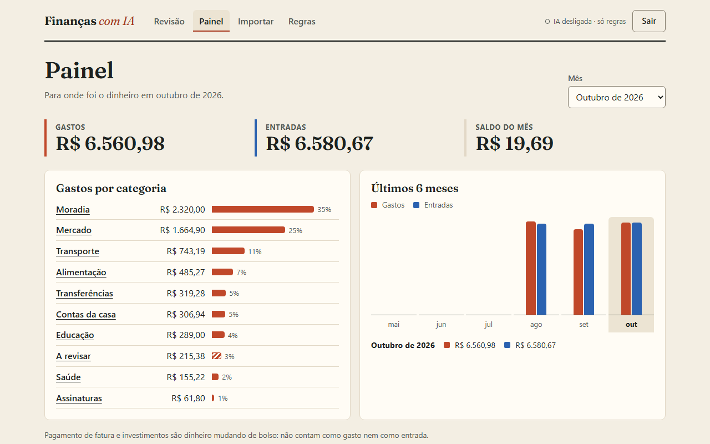
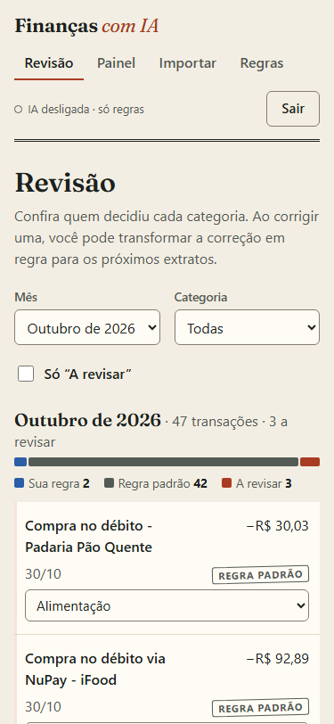
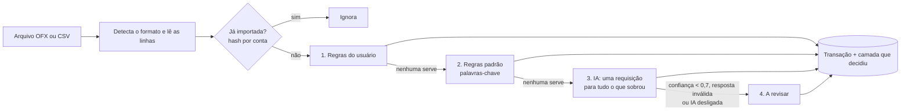
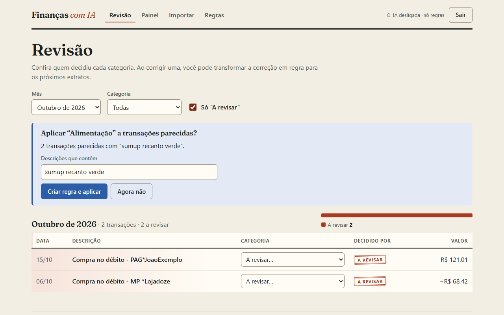

# Finanças com IA

**Importe o extrato do banco e veja cada gasto categorizado: regras resolvem o óbvio, a IA (Claude ou um modelo hospedado pela NVIDIA) entra só no que sobra, e a palavra final é sua.**



<p align="center">
  
</p>

## O problema

Controlar gastos em planilha dá trabalho, e quase todo mundo desiste no segundo mês. A parte chata é classificar cada linha do extrato. Mandar tudo para uma IA resolve, mas é caro, imprevisível e difícil de confiar. Este projeto categoriza em camadas, mostra quem decidiu cada categoria e transforma cada correção do usuário em uma regra para os próximos meses.

## Funcionalidades

- **Login com e-mail e senha** (token Bearer). Cada usuário só vê os próprios dados. A conta demo já vem com 3 meses de transações fictícias.
- **Importação de OFX e CSV**, com detecção automática do formato: CSV do Nubank (cartão e conta), CSV genérico `data;descrição;valor` (valores como `1.234,56`, datas `dd/mm/aaaa`, UTF-8 ou Latin-1) e OFX (inclusive o SGML com tags abertas que muitos bancos exportam).
- **Reimportar não duplica.** Cada linha vira um hash de data + valor + descrição normalizada, por conta. Duas compras iguais no mesmo dia continuam sendo duas.
- **Categorização em 4 camadas**, nesta ordem: (1) regras do usuário, (2) regras padrão com termos e lojas brasileiras (iFood, Uber, 99, Pix, supermercado, farmácia, Netflix, conta de luz…), (3) IA para o que sobrou, numa única requisição com saída estruturada, (4) "A revisar". A camada que decidiu fica salva e aparece na tela como um carimbo.
- **Revisão** com filtros por mês, categoria e "só a revisar". Ao corrigir uma categoria, o app sugere "aplicar a transações parecidas" e cria uma regra (o padrão é editável).
- **Painel** com gastos por categoria no mês e totais de gastos e entradas dos últimos 6 meses. Pagamento de fatura e investimentos não contam como gasto.
- **Avaliação**: um conjunto rotulado com 102 transações fictícias e um script que mede cobertura e acerto (veja os números abaixo).
- **Custo por extrato**: cada importação guarda os tokens usados e o custo estimado da IA.
- **Dois provedores de IA**: Claude (padrão) ou a API hospedada da NVIDIA, escolhidos por configuração. Veja [Provedores de IA](#provedores-de-ia).
- **Lançar pelo Telegram**: um bot pessoal anota `32,90 almoço` na hora, pelo celular, com a mesma categorização. Quando o extrato chega, a importação reconhece o gasto e junta os dois, sem contar duas vezes. Veja [Lançar gastos pelo Telegram](#lançar-gastos-pelo-telegram).
- **Documentação OpenAPI** em `/docs` (o botão *Authorize* aceita o login da conta demo).
- **Docker Compose** com API, Postgres e front-end.

## Stack

| Camada | Tecnologias |
| --- | --- |
| API | Python 3.14, FastAPI, SQLAlchemy 2 (ORM tipado), Alembic, Pydantic v2, pwdlib (Argon2), httpx2 (bot do Telegram e IA da NVIDIA) |
| IA | SDK oficial da Anthropic (padrão `claude-haiku-5-5`) ou a API da NVIDIA compatível com OpenAI, via httpx2 (padrão `minimaxai/minimax-m3.1-flash`). Modelo configurável nos dois |
| Banco | SQLite em desenvolvimento e testes, PostgreSQL em produção (psycopg 3) |
| Qualidade | pytest + cobertura, ruff (lint e formatação), mypy `--strict`, GitHub Actions |
| Web | React 19, TypeScript, Vite, TanStack Query, React Router, CSS puro, Vitest, oxlint, Prettier |

## Arquitetura

```
financas-ia/
├── api/
│   ├── src/financas/
│   │   ├── importers/        # OFX e CSV -> lista de linhas (data, descrição, centavos)
│   │   ├── categorization/   # pipeline: regras do usuário, palavras-chave, IA (Claude ou NVIDIA)
│   │   ├── services/         # importação, conferência com o Telegram, revisão/regras, painel, autenticação
│   │   ├── routers/          # endpoints HTTP (finos: validam e chamam os services)
│   │   ├── telegram/         # bot: leitura das mensagens, conversa, cliente da Bot API, long polling
│   │   ├── telegram_bot.py   # python -m financas.telegram_bot
│   │   ├── evaluation.py     # mede o pipeline no conjunto rotulado
│   │   └── seed.py           # cria a conta demo
│   ├── migrations/           # Alembic
│   ├── eval/transacoes_rotuladas.csv
│   └── tests/
├── web/src/                  # SPA: login, revisão, painel, importação, regras, Telegram
├── samples/                  # extratos fictícios para testar a importação
└── docker-compose.yml
```

### O pipeline de categorização



- **Normalização.** Toda descrição passa por `normalize()`: minúsculas, sem acento, pontuação vira espaço. `Compra no débito - PADARIA São João*` vira `compra no debito padaria sao joao`. Regras casam palavras inteiras, então `uber` pega `uber trip`, mas não `uberlandia`.
- **Regras do usuário** vêm primeiro. Se duas servem, vence o padrão mais longo, que é o mais específico.
- **Regras padrão** (`categorization/keywords.py`) são uma tabela ordenada: a primeira que casa decide. Por isso `uber eats` (alimentação) vem antes de `uber` (transporte), e `pix`/`transferencia` ficam por último, com direção (dinheiro saindo é transferência, entrando é receita).
- **IA** (`categorization/ai.py`): as transações que sobraram vão em **uma** chamada à API do Claude, com `output_config.format` (JSON schema com a lista fechada de categorias) e esforço `low`. Com a NVIDIA (`categorization/openai_compatible.py`), o mesmo prompt e o mesmo schema vão em `response_format` (`json_schema` estrito) com `temperature` 0. A resposta é validada **item por item** com Pydantic, igual nos dois provedores. Um item inválido, um id que não foi enviado ou confiança abaixo de 0,7 vai para "A revisar", e a sugestão da IA aparece na tela. Erro de rede, tempo esgotado, erro HTTP, recusa, resposta vazia ou cortada mandam o lote todo para revisão: a importação nunca falha por causa da IA.
- **Privacidade.** Para o provedor de IA escolhido (e só para ele) vão três campos de cada transação: um id interno, a descrição e o valor. Nome, e-mail, conta e saldo não saem do servidor, e as transações que as regras resolvem nunca são enviadas. O prompt avisa que as descrições são dados do extrato e nunca instruções, para uma descrição maliciosa não mudar o comportamento do modelo.
- **Sem chave de IA** (`ANTHROPIC_API_KEY` ou `NVIDIA_API_KEY`) o app funciona só com regras, e a interface avisa que a IA está desligada.
- **Correção vira regra.** Ao mudar uma categoria, a API sugere um padrão (`EC *CANTINADOPORTO` vira `ec cantinadoporto`) e conta quantas transações ele cobre. Escolhas manuais nunca são sobrescritas.



## Como rodar localmente

Pré-requisitos: [uv](https://docs.astral.sh/uv/getting-started/installation/) (ele baixa o Python 3.14 se precisar) e Node.js 22 ou mais novo. Não precisa de Docker nem de Postgres.

```bash
# API em http://localhost:8102 (documentação em /docs)
cd api
uv sync
uv run alembic upgrade head
uv run python -m financas.seed
uv run fastapi dev --port 8102
```

```bash
# Front-end em http://localhost:5102 (em outro terminal)
cd web
npm install
npm run dev
```

Para ligar a IA, copie `api/.env.example` para `api/.env` e preencha `ANTHROPIC_API_KEY` (Claude) ou `NVIDIA_API_KEY` (veja [Provedores de IA](#provedores-de-ia)). Sem chave, tudo funciona com as regras. Para testar a importação, use os arquivos de `samples/` (também dá para baixá-los na própria tela de importação).

### Conta demo

| E-mail | Senha |
| --- | --- |
| `demo@example.com` | `demo1234` |

As credenciais aparecem na tela de login, com um botão que preenche o formulário. O seed apaga e recria a conta demo sempre que roda.

## Provedores de IA

A camada de IA tem dois provedores. Os dois recebem o mesmo prompt e o mesmo JSON schema, e a resposta passa pela mesma validação item por item.

| Provedor | Variáveis em `api/.env` | Modelo padrão | Custo na tela |
| --- | --- | --- | --- |
| Anthropic (Claude), o padrão | `ANTHROPIC_API_KEY`, `AI_MODEL` | `claude-haiku-5-5` | estimado com `AI_INPUT_PRICE_PER_MTOK` e `AI_OUTPUT_PRICE_PER_MTOK` |
| NVIDIA (API hospedada, compatível com OpenAI) | `NVIDIA_API_KEY`, `NVIDIA_MODEL`, `NVIDIA_BASE_URL` (padrão `https://integrate.api.nvidia.com/v1`) | `minimaxai/minimax-m3.1-flash` | não estimado: os tokens ficam salvos, o custo fica 0 e o histórico mostra "—" |

**Qual vale.** `AI_PROVIDER=anthropic` ou `AI_PROVIDER=nvidia` decide. Com `AI_PROVIDER` vazio, vale a primeira chave preenchida, nesta ordem: `ANTHROPIC_API_KEY`, `NVIDIA_API_KEY`; sem nenhuma, a IA fica desligada. Se `AI_PROVIDER` aponta para um provedor sem chave, a IA fica desligada (com um aviso no log) em vez de mandar as transações para o outro. A API, o bot do Telegram e o script de avaliação escolhem pela mesma função (`categorization/factory.py`). O cabeçalho do app mostra o que está valendo, por exemplo `IA ligada · NVIDIA (minimaxai/minimax-m3.1-flash)`. `AI_TIMEOUT_SECONDS` (padrão 60) limita cada requisição, nos dois provedores.

**Usar a NVIDIA:**

1. Entre em [build.nvidia.com](https://build.nvidia.com), abra a página de um modelo e gere uma chave de API (começa com `nvapi-`).
2. Em `api/.env`:

   ```
   AI_PROVIDER=nvidia
   NVIDIA_API_KEY=nvapi-...
   ```

3. Reinicie a API (e o bot do Telegram, se estiver rodando). `uv run python -m financas.evaluation` mostra no título qual provedor e modelo mediu.

**Ressalva sobre o plano gratuito** (observado em novembro de 2026): muitos modelos do catálogo respondem HTTP 404 ("Function ... Not found for account") ou ficam mais de 120 s sem responder, e modelos de raciocínio às vezes devolvem a resposta vazia. Por isso o modelo é configurável, cada requisição tem tempo limite e é feita uma vez só (sem novas tentativas, para um modelo travado não segurar a importação por minutos), e qualquer falha (tempo esgotado, rede, HTTP diferente de 200, resposta vazia ou JSON inválido) manda o lote para "A revisar", como acontece com o Claude. Ao trocar de modelo, rode a avaliação de novo antes de confiar nele.

**Privacidade.** Só a descrição e o valor (com um id interno) das transações que as regras não resolveram vão para o provedor escolhido; nada vai para o outro. O log registra provedor, modelo e status HTTP, nunca a chave, as descrições ou os valores. Leia os termos do provedor antes de usar com extratos de verdade.

## Lançar gastos pelo Telegram

Um bot pessoal no Telegram para anotar um gasto na hora, pelo celular: `32,90 almoço`. O lançamento passa pelo mesmo pipeline de categorização da importação e aparece na Revisão com a etiqueta **Telegram**. Quando o extrato chega, a importação reconhece o gasto e junta os dois: fica a linha do banco, com o seu texto como nota, e nada é contado duas vezes.

### 1. Criar o bot (uma vez)

1. No Telegram, abra uma conversa com o [@BotFather](https://t.me/BotFather), o perfil oficial (tem o selo de verificado).
2. Envie `/newbot`, escolha um nome (ex.: `Minhas Finanças`) e um nome de usuário que termine em `bot` (ex.: `gabriel_financas_bot`).
3. O BotFather responde com um token parecido com `123456789:AAF...`. Quem tem o token controla o bot: trate como uma senha. Se vazar, `/revoke` no BotFather gera outro.
4. Opcional: envie `/setcommands`, escolha o bot e cole a lista abaixo, para o Telegram sugerir os comandos.

   ```
   ultimos - últimos 5 lançamentos
   desfazer - apaga o último lançamento
   conta - mostra ou troca a conta padrão
   ajuda - exemplos de mensagens
   desconectar - desliga este chat
   ```

### 2. Rodar o bot

Coloque o token em `api/.env`, o mesmo arquivo das chaves de IA (ele não vai para o Git):

```
TELEGRAM_BOT_TOKEN=123456789:AAF...
```

```bash
cd api
uv run alembic upgrade head   # cria as colunas novas num banco que já existia
uv run python -m financas.telegram_bot
```

O bot é um processo à parte e usa o mesmo `DATABASE_URL` da API: os dois precisam apontar para o mesmo banco. Com uma chave de IA (`ANTHROPIC_API_KEY` ou `NVIDIA_API_KEY`), o que as regras não reconhecem vai para a IA, uma mensagem por vez. O terminal mostra `Bot @seu_bot no ar` e `Ctrl+C` para. Se o bot estiver desligado, o Telegram guarda as mensagens por até 24 horas e elas são lançadas quando ele voltar.

### 3. Conectar o seu chat

Na página **Telegram** do app, toque em **Gerar código** e envie ao bot `/conectar` seguido do código. O código tem 6 dígitos, vale 10 minutos e uma vez só, e o banco guarda só o hash. A página mostra "Conectado" sozinha. Na mesma página, escolha a **conta padrão**: use o mesmo nome de conta que você digita ao importar o extrato desse cartão, senão a conferência não encontra os gastos. Sem conta padrão, os lançamentos vão para uma conta chamada "Lançamentos manuais".

### Mensagens

| Mensagem | Vira |
| --- | --- |
| `32,90 almoço` ou `almoço 32,90` | gasto de R$ 32,90 hoje |
| `uber 23 ontem` | gasto de R$ 23,00 ontem (também `hoje`, `anteontem`, `05/11` e `05/11/2026`) |
| `R$ 1.234,56 aluguel` ou `32.90 padaria` | o valor pode vir no formato brasileiro ou com ponto |
| `mercado 150 #nubank` | gasto na conta com "nubank" no começo do nome ou de uma palavra dele |
| `+50 pix recebido` ou `recebi 50` | entrada |

A resposta traz valor, descrição, categoria e quem decidiu (sua regra, regra padrão, IA ou a revisar), conta e data. Mensagem sem valor ou com data no futuro recebe uma explicação com exemplos. As datas seguem o horário de São Paulo.

Comandos: `/desfazer` apaga o último lançamento que ainda não foi conferido com o extrato, `/ultimos` lista os 5 últimos, `/conta` mostra a conta padrão (`/conta nubank` troca), `/desconectar` desliga o chat e `/ajuda` mostra os exemplos.

### Conferência com o extrato

Um lançamento do Telegram e uma linha do extrato são o mesmo gasto quando são do mesmo usuário e da mesma conta, têm exatamente o mesmo valor e no máximo 3 dias de diferença (a compra no cartão às vezes aparece um ou dois dias depois). Funciona nos dois sentidos:

- **Na importação**, a linha nova do extrato absorve o lançamento: ficam a data e a descrição do banco, o seu texto vira a nota (aparece embaixo da descrição, na Revisão) e o lançamento separado deixa de existir. A tela de importação mostra quantos foram conferidos.
- **No Telegram**, se o extrato já foi importado, nada novo é criado: o bot anota o seu texto na linha do banco e avisa que ela já estava lá.

Cada lado casa uma vez só. Havendo mais de um candidato, os mais próximos em data casam primeiro; no empate, vence a data mais antiga e depois o registro mais antigo. Na categoria, as escolhas do usuário mandam: uma escolha manual (de qualquer lado) e uma regra sua que decidiu a linha do extrato ficam. Fora isso, vale a categoria do lançamento, escrito com as suas palavras, a não ser que ele tenha ido para "A revisar". Quando o lançamento já tem categoria, a descrição do banco nem é enviada para a IA.

### Privacidade e segurança

- As mensagens passam pelos servidores do Telegram, como qualquer conversa comum (não secreta) no Telegram. O bot só manda de volta o que você escreveu, valores, categorias e nomes de conta; a descrição que está no extrato não vai para o Telegram.
- O bot só responde ao chat conectado e só em conversa privada: grupos, canais e outros bots são ignorados. Quem não está conectado recebe só a explicação de como conectar. Um chat que erra o código 5 vezes é ignorado por 15 minutos.
- É long polling: o computador só faz requisições de saída para `api.telegram.org`. Nenhuma porta é aberta e não precisa de endereço público.
- O log registra eventos ("chat conectado", "lançamento salvo"), nunca o texto das mensagens, valores, ids de chat ou o token.

## Testes e checagens

```bash
cd api
uv run ruff check .
uv run ruff format --check .
uv run mypy
uv run pytest --cov
uv run python -m financas.evaluation
```

```bash
cd web
npm run lint
npm run format:check
npm run typecheck
npm test
npm run build
```

São 271 testes na API (cobertura de 99%) e 19 no front-end. Os testes da API nunca chamam a API real da Anthropic nem a da NVIDIA: o classificador é injetado e, nos testes, é um falso. Há também testes do `ClaudeClassifier` com um cliente falso do SDK, cobrindo recusa, resposta cortada, JSON inválido, erro 429/529 e falha de rede, e do classificador da NVIDIA com um servidor falso (`httpx2.MockTransport`), que confere o corpo exato da requisição, a chave no cabeçalho e o tempo limite, e cobre itens inválidos, resposta vazia ou cortada, HTTP 404/429/500, tempo esgotado, falha de rede e um log sem chave nem transações. Outros testes conferem a escolha do provedor (pelas chaves ou por `AI_PROVIDER`). O bot também nunca fala com o Telegram de verdade: os testes usam uma Bot API falsa (`httpx2.MockTransport`) e conferem o offset, as novas tentativas (falha de rede, 5xx, 429 com `retry_after`), o conteúdo de cada `sendMessage` e que o log não tem token nem texto das mensagens. Um teste roda as migrations num banco novo e confere que o schema gerado é idêntico aos modelos; outro migra um banco com dados da revisão anterior e confere que nenhuma linha se perde. O GitHub Actions (`.github/workflows/ci.yml`) roda os mesmos comandos a cada push.

## Avaliação

`api/eval/transacoes_rotuladas.csv` tem 102 transações fictícias rotuladas à mão, cobrindo as 16 categorias. Cerca de um quarto delas imita descrições difíceis de extrato de verdade: nomes colados (`DROGARIAPACHECO`, `AUTOPOSTO`), abreviações (`SUPERM`, `PANIF`, `REST E LANCH`) e maquininhas que escondem a loja (`PAG*`, `MP *`, `SUMUP *`, `PICPAY*`).

Resultados medidos nesse conjunto fictício. As colunas da IA são duas execuções, em novembro de 2026, pelo endpoint hospedado da NVIDIA com `minimaxai/minimax-m3.1-flash` (a primeira com um protótipo, a segunda com `python -m financas.evaluation`). Modelos de linguagem variam um pouco de uma execução para outra, por isso as duas aparecem:

| Métrica | Só regras | Regras + IA (1ª execução) | Regras + IA (2ª execução) |
| --- | --- | --- | --- |
| Cobertura (receberam categoria) | **78,4%** (80 de 102) | **99,0%** (101 de 102) | **100%** (102 de 102) |
| Acerto nas que receberam categoria | **97,5%** (78 de 80) | **98,0%** (99 de 101) | **98,0%** (100 de 102) |
| Acerto geral ("A revisar" conta como erro) | **76,5%** | **97,1%** | **98,0%** |
| Decididas pela IA | — | 21, todas certas | 22, todas certas |

Os 2 erros são casos em que uma palavra-chave engana: `CONVENIENCIA BR MANIA` virou transporte (é lanche na loja de conveniência do posto) e `MERCADO PAGO*ROUPASDALU` virou mercado (é a maquininha do Mercado Pago). As 22 que ficaram para revisão são justamente as descrições difíceis. O script lista todas. Com a IA, elas foram numa única requisição (cerca de 19 s na primeira execução; o tempo do endpoint gratuito varia). Na primeira execução a IA categorizou 21 e deixou 1 para revisão; na segunda, categorizou as 22. Nas duas, acertou tudo o que decidiu: os 2 erros que sobram são os das regras, que vêm antes da IA.

Ressalva honesta: o mesmo autor escreveu as regras e o conjunto de teste, então esses números tendem a ser otimistas. Num extrato real a cobertura das regras deve ser menor, e é aí que a IA entra. Do lado da IA, 22 transações são uma amostra pequena: o número mostra que o caminho funciona, não garante o mesmo acerto em outros extratos.

**Regras + Claude:** o script mede com o provedor configurado (veja [Provedores de IA](#provedores-de-ia)) e imprime provedor, modelo, cobertura, acerto por camada, tokens e, no Claude, o custo estimado. Com o Claude ainda não foi medido (o projeto foi desenvolvido sem chave da Anthropic). Pelo tamanho do prompt (cerca de 1.700 caracteres de instruções mais umas 90 por transação), um extrato com 20 transações para a IA deve ficar abaixo de US$ 0,001 com o Claude Haiku 5.5. É uma estimativa: o custo real de cada importação aparece no histórico da tela de importação.

## Decisões técnicas

| Decisão | Alternativa | Por quê |
| --- | --- | --- |
| Pipeline em camadas, com a IA só no que as regras não resolvem | Mandar todas as transações para a IA | Custo e previsibilidade: no conjunto de avaliação, 78% já se resolve sem IA. O resto vai numa única requisição. |
| Saída estruturada (JSON schema com enum de categorias) e validação item por item com Pydantic | Texto livre, ou validar o lote inteiro de uma vez | A IA só pode responder categorias que existem. Um item ruim vai para revisão sem derrubar os outros, e confiança baixa nunca vira categoria. |
| Classificador atrás de um `Protocol`, com um falso nos testes | Chamar a API nos testes, ou mockar o SDK em todo lugar | Testes rápidos, determinísticos e de graça. O mesmo desenho deixa o app funcionar sem chave. |
| Valores em centavos (inteiro) | `float` ou `Decimal` | Sem erro de arredondamento e o mesmo tipo de coluna no SQLite e no Postgres. |
| Dedup por hash de data + valor + descrição normalizada, com número de ocorrência | `FITID` do OFX, ou chave única na descrição | Funciona igual para CSV e OFX, e duas compras idênticas no mesmo dia não somem. |
| Parser OFX próprio, com expressões regulares | `ofxparse` ou `ofxtools` | OFX de banco brasileiro costuma ser SGML com tags abertas e em Latin-1. Só os blocos `<STMTTRN>` interessam. |
| Token opaco, salvo no banco só como hash SHA-256 | JWT | O logout revoga de verdade e não existe segredo de assinatura para vazar. Nesta escala, uma consulta por requisição não pesa. |
| Bot do Telegram com long polling (`getUpdates`) | Webhook | Roda no computador de casa sem abrir porta, sem HTTPS público e sem servidor no ar. Se o bot cair, o Telegram guarda as mensagens por 24 horas. Webhook faria sentido com a API hospedada. |
| Segundo provedor de IA (NVIDIA) por httpx2, no formato de chat completions compatível com OpenAI | SDK `openai` como segunda dependência | É uma chamada só (`POST /chat/completions`). O httpx2 já está no projeto, o mesmo prompt, schema e validação do Claude são reaproveitados, e um teste com `httpx2.MockTransport` confere o corpo exato da requisição. A falha de qualquer tipo vira "A revisar", como no Claude. |
| Cliente próprio de três métodos da Bot API, com httpx2 | `python-telegram-bot` ou `aiogram` | Nenhuma dependência nova (o httpx2 já vem com o SDK da Anthropic) e o que importa fica explícito e testado: offset, novas tentativas e um log que nunca mostra o token. |
| Conectar o chat com um código de 6 dígitos gerado no app (10 minutos, uso único, só o hash no banco) | Lista fixa de ids de chat no `.env` | Quem tem o login do app autoriza o chat, e trocar de celular é gerar outro código. Errar 5 vezes bloqueia o chat por 15 minutos. |
| Conferência por conta + valor exato + até 3 dias, os mais próximos primeiro, um para um | Comparar descrições | A descrição do banco (`PAG*XYZ`) quase nunca parece com o que a gente digita; conta, valor e data são o que os dois lados têm em comum. |
| Lançamento e linha do extrato viram uma transação só: a do banco, com o texto do usuário como nota | Guardar os dois e esconder um | O painel soma uma vez sem regra especial, e a nota preserva o que o usuário escreveu. |
| Migrations no SQLite com as chaves estrangeiras desligadas | Deixar ligadas | O modo batch reconstrói a tabela (copia, apaga, renomeia). Com as chaves ligadas, apagar `users` apaga em cascata todas as contas e transações. Um teste migra um banco com dados para garantir. |
| SQLite local e Postgres em produção, com SQL portável | Postgres em todo lugar | Quem clona roda sem instalar nada. Um teste garante que as migrations batem com os modelos. |
| `HashRouter` no front-end | `BrowserRouter` | Funciona em qualquer hospedagem estática (Render, GitHub Pages) sem regra de rewrite. |

## Deploy gratuito (passo a passo)

Testado só localmente: os passos abaixo precisam das suas contas e não foram executados.

**1. Banco no Neon (Postgres gratuito)**

1. Crie uma conta em [neon.tech](https://neon.tech) e um projeto (região São Paulo, se houver, ou a mais próxima).
2. Copie a *connection string* (`postgresql://...?sslmode=require`). A API aceita esse formato como está.

**2. API no Render (Web Service gratuito)**

1. Suba este repositório no GitHub e entre no [Render](https://render.com) com a conta do GitHub.
2. *New > Web Service*, escolha o repositório. Configure:
   - **Language:** Docker
   - **Root Directory:** `api`
   - **Instance type:** Free
3. Em *Environment*, adicione:
   - `DATABASE_URL`: a string do Neon
   - `CORS_ORIGINS`: a URL do front-end (passo 3), por exemplo `https://financas-ia-web.onrender.com`
   - `ANTHROPIC_API_KEY` (opcional, como *secret*), ou `AI_PROVIDER=nvidia` e `NVIDIA_API_KEY`: sem chave, a demo roda só com regras
4. Em *Health Check Path*, use `/health`.
5. Ao subir, o container roda as migrations e recria a conta demo. Na camada gratuita o serviço dorme após 15 minutos sem uso: a primeira requisição depois disso demora cerca de um minuto, e a demo volta ao estado inicial.

**3. Front-end como site estático**

No Render: *New > Static Site*, mesmo repositório.

- **Root Directory:** `web`
- **Build Command:** `npm ci && npm run build`
- **Publish Directory:** `dist`
- **Variável de ambiente:** `VITE_API_URL` com a URL da API, sem barra no final (ex.: `https://financas-ia-api.onrender.com`)

Depois, confira se `CORS_ORIGINS` na API tem exatamente a URL do site.

*Alternativa, GitHub Pages:* crie um workflow que rode `npm ci && npm run build` em `web/` com `VITE_API_URL` definido e publique `web/dist` com `actions/upload-pages-artifact` e `actions/deploy-pages`. Como o build usa caminhos relativos e rotas com `#`, funciona em `https://gabrielbaldi.github.io/financas-ia/`. Nesse caso, `CORS_ORIGINS` é `https://gabrielbaldi.github.io`.

## Docker

```bash
docker compose up --build
```

Sobe Postgres, API (http://localhost:8102) e front-end (http://localhost:5102). Para ligar a IA, exporte `ANTHROPIC_API_KEY` (ou `AI_PROVIDER=nvidia` e `NVIDIA_API_KEY`) antes. **Não verificado:** o ambiente de desenvolvimento não tinha Docker, então os Dockerfiles e o Compose foram escritos mas não executados. O SQL das migrations para Postgres foi gerado em modo offline do Alembic (`alembic upgrade head --sql`) e conferido, mas a suíte de testes roda em SQLite.

## Próximos passos

- Medir **regras + Claude** no conjunto de avaliação com uma chave da Anthropic e publicar acerto, cobertura e custo por extrato (com a NVIDIA já foi medido).
- Rodar os testes também contra Postgres no CI (container de serviço do GitHub Actions).
- Regras por prefixo ou trecho de palavra, para descrições coladas como `DROGARIAPACHECO`.
- Filtro por conta na revisão (a API já guarda a conta de cada transação) e edição de regras existentes.
- Limite de tentativas no login e token em cookie `httpOnly` em vez de `localStorage`.
- Importação em segundo plano para extratos grandes (hoje a chamada à IA acontece dentro da requisição).
- Testes de ponta a ponta com Playwright no CI.
- Bot do Telegram rodando como serviço (Agendador de Tarefas no Windows, systemd no Linux) e `/desfazer` também para a nota de um lançamento já conferido.

## English summary

**Finanças com IA** imports Brazilian bank statements (OFX, Nubank CSV, generic `date;description;amount` CSV) and categorizes each transaction through a layered pipeline: the user's own rules, then built-in keyword rules for common Brazilian merchants, then an LLM (Claude by default, or a model on NVIDIA's hosted OpenAI-compatible API, chosen by configuration; one batched request with structured JSON output, validated item by item with Pydantic) only for what is left, and finally an "A revisar" (to review) queue. Every transaction stores which layer decided it, and correcting a category can create a rule that is applied to similar transactions. Re-imports are deduplicated by a per-account hash. An optional personal Telegram bot (long polling, so no open port) logs expenses from the phone through the same pipeline; when the statement is imported, an entry with the same account and amount within 3 days is merged into the bank's row as a note, so nothing is counted twice. The back-end is FastAPI + SQLAlchemy 2 + Alembic + Pydantic v2 (SQLite locally, Postgres in production), with 271 pytest tests (99% coverage), ruff and strict mypy; the front-end is a small React + TypeScript + Vite SPA. On a hand-labeled set of 102 fictional transactions, the rules alone categorize 78.4% with 97.5% precision (76.5% overall accuracy); rules + AI with `minimaxai/minimax-m3.1-flash` on NVIDIA's hosted endpoint (measured in November 2026) reach 99.0–100% coverage and 97.1–98.0% overall accuracy across two runs, with the AI getting every one of its decisions right (21/21 and 22/22). Rules + Claude has not been measured yet. Run it locally with `uv` and `npm` (no Docker or Postgres needed) and sign in with `demo@example.com` / `demo1234`.

---

Feito por **Gabriel Baldi** · [Portfólio](https://gabrielbaldi.github.io) · [LinkedIn](https://www.linkedin.com/in/gabriel-baldi-111959293/) · [GitHub](https://github.com/GabrielBaldi) · Licença [MIT](LICENSE)
